  

  <h1>
    Hi!  I'm Gábor
  </h1>

  

    
  

  

 

## ⚡ A few quick facts

* 👨‍💻 Full Stack Developer at **Tieto Caretech**, primary developer of **Lifecare Patient Insights**: patient information from many systems in one view for healthcare professionals
* 🧰 Working mostly with **React, TypeScript, Node.js, GraphQL & PostgreSQL**
* ☁️ Also doing a lot of **Azure, Terraform, Docker, Kubernetes, Helm & Azure DevOps**
* 🏥 Contributing to the **HUS DataLake** platform, making healthcare data available across different systems
* 🚀 Working with large healthcare systems from implementation all the way to infra and production releases, across multiple customer environments
* 🤖 Built LLM-based prototypes: a diagnostic-support proof of concept at Helsinki's **New Children's Hospital** and a demo at **ATK-päivät**
* 🦾 Running several AI coding agents (**Claude Code, Codex**) in parallel, and reviewing and testing everything they write myself
* 🔧 I like taking ownership and figuring things out, even when it’s a part of the system I haven’t worked with that much before
* 🔐 Familiar with security and compliance work, including **ISO 27001**
* 🐝 Alumni of **Hive Helsinki**
* 🎮 Messing around with **Godot**, mobile games and multiplayer ideas in my free time
* 😄 Fun fact: I can solve a Rubik's Cube in around 30 seconds

 

---

## 🌿 On the trail

A few things I've been building lately.

<h3>🧭 The Explorer</h3>

My own offline-first GPS exploration / field research app. 
Built it from scratch and somehow got it all the way to Google Play. :)

<b>React Native · TypeScript · Expo · MapLibre · Supabase · Auth0</b>

  

 

 

  

📍 GPS tracking · 🗺️ Offline data · 📸 Photos · ☁️ Sync · 📤 GPX / KML / GeoJSON / CSV

  

<h3>🧠 Neural Decompiler</h3>

My own mechanistic-interpretability research project. 
What is a transformer language model actually computing? Tracing it through attention heads and MLP neurons, one preregistered experiment at a time.

<b>Python · PyTorch · TransformerLens · Pythia</b>

  

<h3>🕵️ The AI Timeline</h3>

An investigation board for the history of AI, 1900 to 2050: pinned entries, strings between them, and a case note for every connection.

 

---

## 🔨 Some older projects

🔥 <a href="https://github.com/mobahug/instagram_clone_42_SP">Instagram Clone</a>
  •  
🔥 <a href="https://github.com/mobahug/TinderClone_42">Tinder Clone</a>
  •  
🔥 <a href="https://github.com/mobahug/Netflix_Clone_42">Netflix Clone</a>

 

---

## 📫 Contact me

 

 

---

## 📊 GitHub stuff

  

 

---

<h2 align="center">🚀 Languages & development</h2>

 

 

---

<h2 align="center">🔧 Tools / cloud / things I break and fix</h2>

 

  

<picture>
  <source media="(prefers-color-scheme: dark)" srcset="https://raw.githubusercontent.com/mobahug/mobahug/output/github-contribution-grid-snake-dark.svg">
  
</picture>

 

